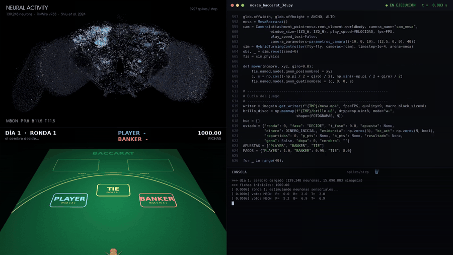
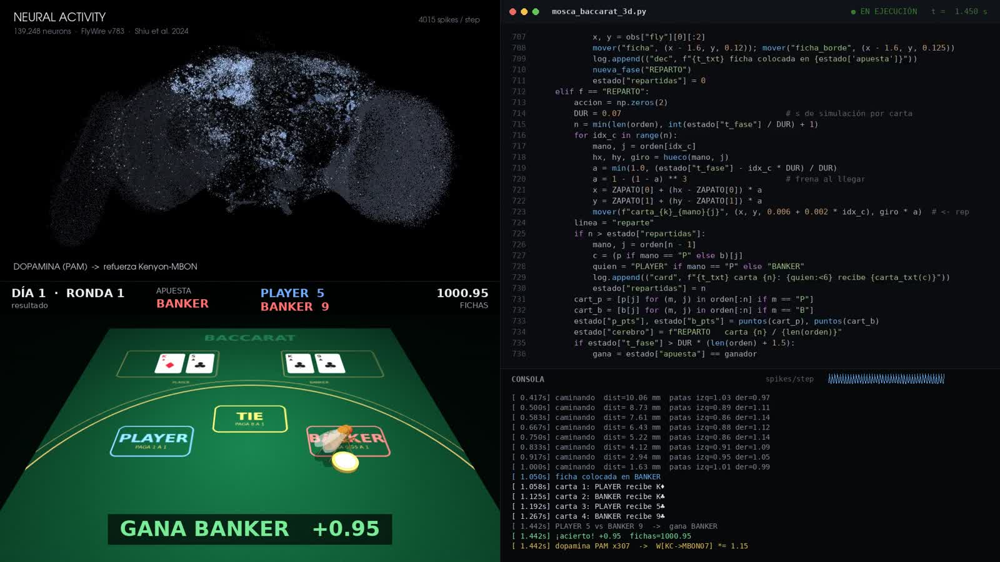

# Una mosca de la fruta jugando al baccarat



Un compañero enseñó a una mosca a jugar al Mario Bros y me picó la curiosidad. Esto es lo que salió de ahí: el cerebro real de una *Drosophila melanogaster* (139.248 neuronas y 15 millones de conexiones, sacadas del conectoma de FlyWire) simulado en Python, metido en un cuerpo de mosca en 3D y sentado en una mesa de baccarat.

La mosca decide su apuesta con su propio circuito de aprendizaje, camina hasta la casilla, se reparten las cartas con las reglas reales y, según gane o pierda, recibe dopamina de premio o de castigo que cambia sus conexiones para la siguiente ronda.

Ya aviso: el baccarat es azar, así que no va a hacerse rica. La gracia no es ganar, sino ver cómo un cerebro real aprende de lo que le pasa.

## Cómo funciona

**El cerebro.** Las posiciones de las neuronas y la tabla de conexiones vienen del conectoma FlyWire v783 (Dorkenwald et al. 2024). Sobre eso corre un modelo integra-y-dispara como el de Shiu et al. 2024: cada neurona acumula voltaje, dispara al pasar un umbral y descansa unos pasos. Las conexiones llevan su signo, así que unas excitan y otras inhiben. Unas cuantas neuronas sensoriales reciben estímulos y la actividad se propaga sola por el cerebro.

**La decisión.** Cada apuesta (PLAYER, BANKER, TIE) está asociada a una familia de neuronas de salida del cuerpo fungiforme, las MBON, que es la zona donde las moscas aprenden por asociación. Durante un momento, esas tres familias "votan" con su actividad y gana la que más dispara.

**El aprendizaje.** Si la apuesta sale bien, se activan las neuronas de dopamina PAM y se refuerzan las conexiones Kenyon → MBON que estaban activas cuando decidió. Si sale mal, se activan las PPL1 y esas conexiones se debilitan. Es una versión simplificada de cómo aprende una mosca de verdad qué olor lleva a comida.

**El cuerpo.** La mosca 3D es NeuroMechFly v2 (EPFL), con 87 articulaciones y física con MuJoCo. Para moverse uso su controlador de marcha: el cerebro decide a qué casilla ir y el controlador se encarga de las patas.

**La memoria.** Al terminar cada sesión se guarda lo aprendido en `memoria_mosca.npz`, y la siguiente empieza el "día" siguiente con ese cerebro. Así se puede ver cómo cambian sus apuestas con la experiencia.



## Estructura

El repositorio sigue el orden en que lo fui construyendo:

```
01_cerebro_simulado/   el principio: un cerebrito inventado (35 y luego 51 neuronas)
                       aprendiendo baccarat con dopamina, con visores 2D y 3D
02_flywire/            paso a datos reales: células de Kenyon, MBON, DAN y neuronas
                       de proyección de FlyWire, y una mosca que juega con ese circuito
03_cerebro_completo/   las 139.248 neuronas con actividad propagándose por el conectoma
04_mosca_3d/           el cuerpo NeuroMechFly en la mesa de baccarat:
                         mosca_baccarat_3d.py  graba un vídeo con física completa
                         mosca_en_vivo.py      lo mismo, en directo en una ventana
                         mosca_animada.py      la mosca andando con su cerebro al lado
datos_flywire/         aquí van los datos (no están en el repo, ver abajo)
entornos/              los dos entornos de conda
docs/                  imágenes del README
```

## Instalación

Hacen falta dos entornos de conda porque Brian2 (carpetas 01 y 02) y el cuerpo de la mosca (carpeta 04) piden versiones distintas de numpy:

```
conda env create -f entornos/mosca.yml
conda env create -f entornos/moscafly.yml
```

- `mosca`: carpetas 01, 02 y 03.
- `moscafly`: carpeta 04 (y también vale para la 03).

## Los datos

Los datos de FlyWire no se incluyen porque pesan bastante y tienen sus propias condiciones de uso. En [datos_flywire/LEEME.md](datos_flywire/LEEME.md) está qué archivos descargar y de dónde. Es gratis y solo hace falta una cuenta de Google.

## Ejecutar

Todo se lanza **desde la carpeta raíz del repositorio**:

```
conda activate moscafly

python 04_mosca_3d/mosca_en_vivo.py              # en directo (ESPACIO pausa, ESC sale)
python 04_mosca_3d/mosca_baccarat_3d.py 60       # graba 60 s de vídeo (un "día")
python 04_mosca_3d/mosca_baccarat_3d.py --nuevo  # olvida lo aprendido y vuelve al día 1
python 03_cerebro_completo/visor_cerebro_estetico.py --video
```

Para las carpetas 01 y 02:

```
conda activate mosca

python 01_cerebro_simulado/visor2.py
python 02_flywire/preparar_cerebro_real.py       # genera cerebro_full.pkl (una vez)
python 02_flywire/visor_cerebro_full.py
```

## Limitaciones (para ser honesto)

- El modelo de neurona es muy simple comparado con una neurona de verdad, y los parámetros (umbral, fuga, ganancia) están ajustados a ojo para que la actividad se mantenga en torno al 1-2 % de neuronas por paso.
- El cerebro decide la apuesta, pero el movimiento de las patas lo hace el controlador de NeuroMechFly. En una mosca real eso lo haría el cordón nervioso, que no está en estos datos.
- Las tres familias de MBON que representan cada apuesta son las que más entrada reciben de las células de Kenyon, no un circuito "de baccarat" (las moscas no juegan a las cartas, que yo sepa).
- La física de 87 articulaciones es pesada: un vídeo de un minuto tarda bastante en renderizarse. El modo en vivo usa animación cinemática (el mismo patrón de marcha, pero sin calcular contactos) para ir fluido.

## Créditos

Este proyecto se apoya en el trabajo de mucha gente:

- **FlyWire**, conectoma del cerebro adulto de *Drosophila*: Dorkenwald et al. (2024), *Neuronal wiring diagram of an adult brain*, Nature. Schlegel et al. (2024), *Whole-brain annotation and multi-connectome cell typing*, Nature.
- **Modelo del cerebro**: Shiu et al. (2024), *A Drosophila computational brain model reveals sensorimotor processing*, Nature.
- **NeuroMechFly v2**: Wang-Chen et al. (2024), *NeuroMechFly v2: simulating embodied sensorimotor control in adult Drosophila*, Nature Methods.
- **Brian2** (simulador de neuronas), **MuJoCo** (física), **PyVista** y **OpenCV**.

## Licencia

El código es MIT (ver [LICENSE](LICENSE)). Los datos de FlyWire siguen sus propias condiciones; si publicas algo hecho con ellos, cita los artículos de arriba.
